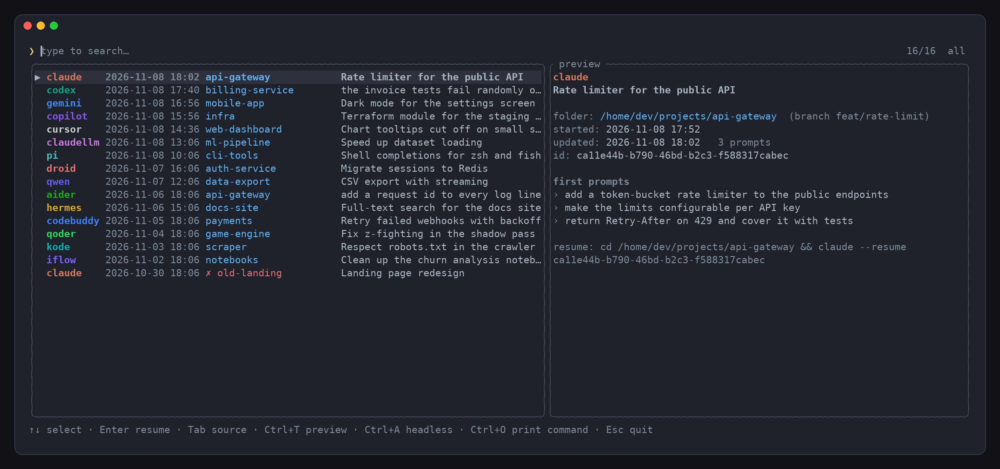
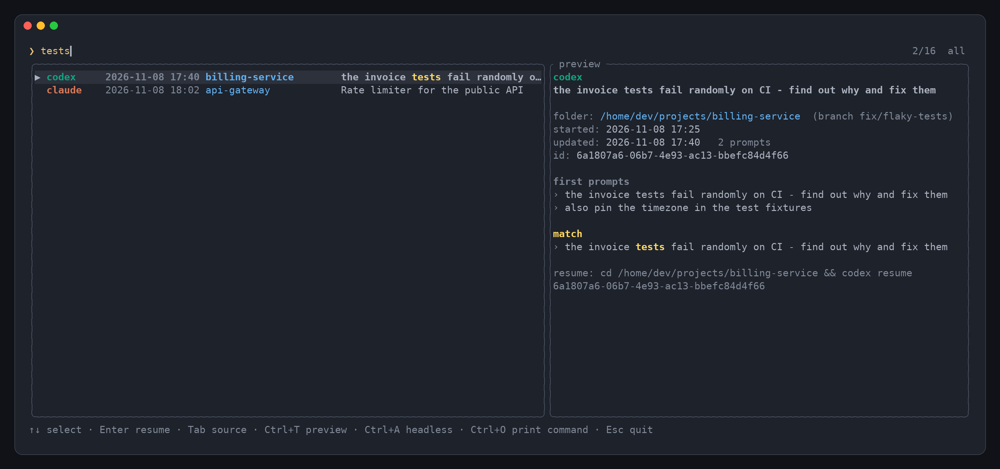
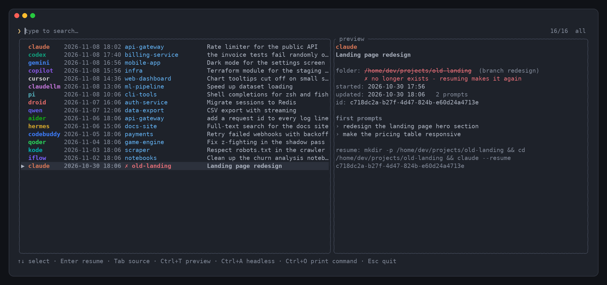

<p align="center"></p>

<h1 align="center">chs</h1>

<p align="center"><b>C</b>onversation <b>h</b>istory <b>s</b>earch: browse, fuzzy-search and resume your recent
terminal AI agent sessions - <b>Claude Code</b>, <b>Codex</b>, <b>Gemini CLI</b>, <b>Copilot CLI</b>, <b>Cursor</b>,
<b>OpenCode</b>, <b>Pi</b>, <b>Qwen Code</b>, <b>Kimi</b>, <b>DeepSeek Harness</b>, <b>Aider</b> and
<a href="#supported-tools">17 more</a> - from one list.</p>

<p align="center"></p>

- **One list for every agent.** [28 tools](#supported-tools) out of the box, found wherever they keep their
  history - plus any extra Claude Code / Codex home (claudellm, work/personal profiles…). Each source has
  its own color; tools you do not use cost nothing.
- **Just type.** The 100 most recent sessions show at once; any letter you type searches the 200 most
  recent, fuzzy and typo-tolerant, in titles, folders and every prompt you wrote. The 20 best matches win.
  All three numbers are set in `[general]`: `recent_count`, `search_pool`, `result_count`.
- **Enter resumes** the session in its own folder (`claude --resume <id>`, `codex resume <id>`, …).
- **Deleted folder?** It is marked `✗` in red. Enter makes it again, empty, at the same path, so the tool
  still finds the session (Claude Code files sessions under the folder they were started in). Set
  `missing_cwd` to `home`, `current` or `abort` for the other behaviours.
- **No daemon.** An incremental on-disk index makes a start cost one `stat` per file (≈10 ms, ≈12 MB),
  and on Linux/macOS chs *replaces itself* with the resumed session, so it holds no memory while you work.
- **Windows tray** (optional), PATH registration and autostart, all switchable in the config.
- **Everything is configurable**: columns, colors, keys, sources, resume commands, search weights, UI language.

<table>
  <tr>
    <td width="50%"></td>
    <td width="50%"></td>
  </tr>
  <tr>
    <td>Type to search: titles, folders and prompts, with the prompt that matched in the preview.</td>
    <td>A deleted project folder is marked; resuming makes it again at the same path.</td>
  </tr>
</table>

## Install

One line, as the user who will run it (no admin rights needed). Run it again to update.

Linux / macOS:

```sh
curl -fsSL https://raw.githubusercontent.com/sergqwer/chs/main/install.sh | sh
```

Windows (PowerShell):

```powershell
irm https://raw.githubusercontent.com/sergqwer/chs/main/install.ps1 | iex
```

The scripts download the latest release into `~/.local/bin` or `%LOCALAPPDATA%\Programs\chs` and run it
once (see below). `CHS_VERSION=v0.2.1` pins a release, `CHS_INSTALL_DIR` picks another folder.

Or by hand: download an archive from [Releases](https://github.com/sergqwer/chs/releases), unpack it
anywhere and run `chs` once - by its full path. That first run puts it on your PATH (see below); from then
on `chs` works from any terminal.

Or build it (Rust 1.85+):

```sh
git clone https://github.com/sergqwer/chs && cd chs
cargo build --release
./target/release/chs          # first run links itself into /usr/local/bin
```

Windows from Linux: `cargo build --release --target x86_64-pc-windows-gnu` (needs `mingw-w64`).

### What the first run sets up

| | Linux / macOS | Windows |
|---|---|---|
| `chs` on PATH | symlink in `/usr/local/bin` (uses `sudo -n` if needed, falls back to `~/.local/bin`) | install folder added to the *user* PATH (`HKCU\Environment`), no admin rights |
| Tray | - | `chs-tray.exe` started, and registered to start with Windows (`HKCU\…\Run`, full path) |

Every start re-syncs this with the config, so switching an option **off removes what it added**:
`[linux] add_to_path`, `[windows] add_to_path`, `tray_enabled`, `tray_autostart`, `start_tray_with_cli`.
`chs --uninstall` removes it all at once; `chs --no-integration` (or `CHS_NO_INTEGRATION=1`) leaves the
system untouched for one run.

## Use

```
chs                  open the list
chs nginx boring     open it with a search already typed
chs -a               include non-interactive sessions (claude -p, codex exec, subagents…)
chs -s codex         only one source
chs -l [query]       print instead of opening the list (-n N, --json); also when stdout is a pipe
chs --reindex        forget the index and re-read every session
```

| Key | Action |
|---|---|
| *any text* | search (words are ANDed; fzf syntax: `'exact` `^prefix` `suffix$` `!exclude`) |
| `↑` `↓` `PgUp` `PgDn` `Ctrl+Home/End` | move |
| `Enter` | resume the selected session |
| `Ctrl+O` / `F4` | print the resume command instead of running it |
| `Tab` / `Shift+Tab` | cycle the source filter: all → each source that has sessions |
| `Ctrl+A` / `F3` | show / hide non-interactive sessions |
| `Ctrl+T` / `F2` | toggle the preview |
| `Ctrl+R` / `F5` | re-index |
| `Ctrl+U`, `Ctrl+W` | clear the search, delete a word |
| `Esc` | clear the search, then quit |

All of them can be rebound in `[keys]`.

### Windows tray

Left click opens chs in a terminal (Windows Terminal, the classic console or a command of your own -
`[windows] terminal`). The menu has *Edit config*, *Open config folder*, *Start with Windows* (writes
`tray_autostart` into the config) and *Quit*. The tray loads nothing: it sleeps in the message loop until
you click, reads the config fresh each time, and launches `chs.exe` by its full path.

## Configuration

`chs --config-path` prints where it is: `~/.config/chs/config.toml` (Linux/macOS),
`%APPDATA%\chs\config.toml` (Windows). It is created on first run with **every option and a comment
explaining it** - see [`config.default.toml`](config.default.toml). Keys you delete fall back to the
defaults, so the file can also hold only what you change.

Your `[[sources]]` entries are merged into the built-in list by `name`, so you write only what you change,
and an entry with a new name adds a source - any number of extra Claude Code / Codex homes, say:

```toml
[[sources]]
name = "gemini"               # a built-in source: switch it off
enabled = false

[[sources]]
name = "work"                 # a new one: label in the list
format = "claude"             # which tool's format (see the table below)
path = "~/.claude-work"       # its data folder, or a list of candidates
color = "#61AFEF"
resume_command = ["claude", "--resume", "{id}"]   # {id} {cwd} {file}; runs in the session's folder
```

`[general] builtin_sources = false` uses only the sources in your file.

A session counts as *non-interactive* when the tool marks it so - `claude -p` and the SDKs, `codex exec`,
`droid exec`, Hermes one-shots, subagents of any tool (`headless_markers` lists the values per source).
They are hidden unless `include_headless = true` or you press `Ctrl+A`.

## Supported tools

| Tool | `format` | Where it is read from | Resume |
|---|---|---|---|
| Claude Code (+ claudellm, any `CLAUDE_CONFIG_DIR`) | `claude` | `~/.claude/projects/*/*.jsonl` | `claude --resume <id>` |
| Codex CLI | `codex` | `~/.codex/sessions/**/rollout-*.jsonl` | `codex resume <id>` |
| Gemini CLI | `gemini` | `~/.gemini/tmp/*/chats/session-*.jsonl` (and the older `.json`) | `gemini --resume <id>` |
| GitHub Copilot CLI | `copilot` | `~/.copilot/session-state/*/events.jsonl` | `copilot --resume=<id>` |
| Cursor CLI | `cursor` | `~/.cursor/chats/*/*/meta.json` + `projects/*/agent-transcripts` | `agent --resume <id>` |
| OpenCode | `opencode` | `~/.local/share/opencode/opencode.db` (1.x and 2.x tables) | `opencode --session <id>` |
| Kilo Code CLI | `kilo` | `~/.local/share/kilo/kilo.db` | `kilo --session <id>` |
| Crush | `crush` | `projects.json` → `<project>/.crush/crush.db` | `crush --session <id>` |
| Goose | `goose` | `~/.local/share/goose/sessions/sessions.db` | `goose session --resume --session-id <id>` |
| Pi | `pi` | `~/.pi/agent/sessions/*/*.jsonl` | `pi --session <file>` |
| Factory Droid | `droid` | `~/.factory/sessions/*/*.jsonl` | `droid --resume <id>` |
| Qwen Code | `qwen` | `~/.qwen/projects/*/chats/*.jsonl` | `qwen --resume <id>` |
| Kimi Code | `kimi` | `~/.kimi-code/sessions/*/*/state.json` + `wire.jsonl` | `kimi --session <id>` |
| Kimi CLI (archived Python) | `kimi-cli` | `~/.kimi/sessions/*/*/wire.jsonl` | `kimi --session <id>` |
| DeepSeek Harness | `dsh` | `~/.dsh/sessions/*/*/session.v<N>.jsonl.zstd` | `dsh headless --session-id <id> -` ¹ |
| Hermes Agent | `hermes` | `~/.hermes/state.db` | `hermes --resume <id>` |
| Antigravity CLI | `antigravity` | `~/.gemini/antigravity-cli/conversation_summaries.db` + `history.jsonl` | `agy --conversation <id>` |
| Mistral Vibe | `vibe` | `~/.vibe/logs/session/{unified/*,session_*}/meta.json` ² | `vibe --resume <id>` |
| Cline CLI | `cline` | `~/.cline/data/sessions/*/` | `cline --id <id> --cwd <folder>` |
| Continue `cn` | `continue` | `~/.continue/sessions/*.json` | `cn --fork <id>` ³ |
| Augment `auggie` | `auggie` | `~/.augment/sessions/*.json` | `auggie --resume <id>` |
| OpenHands CLI | `openhands` | `~/.openhands/conversations/*/` | `openhands --resume <id>` |
| Amazon Q Developer CLI | `amazonq` | `amazon-q/data.sqlite3` in the local data folder | `q chat --resume` |
| CodeBuddy Code | `codebuddy` | `~/.codebuddy/projects/*/*.jsonl` | `codebuddy --resume <id>` |
| Qoder CLI | `claude` | `~/.qoder/projects/*/*.jsonl` | `qodercli --resume <id>` |
| iFlow CLI | `claude` | `~/.iflow/projects/*/*.jsonl` | `iflow --resume <id>` |
| Kode | `claude` | `~/.kode/projects/*/*.jsonl` | `kode --resume <id>` |
| Aider | `aider` | `.aider.chat.history.md` in each repository ⁴ | `aider --restore-chat-history` |

Every path also honours the tool's own override variable (`CODEX_HOME`, `GEMINI_CLI_HOME`, `COPILOT_HOME`,
`PI_CODING_AGENT_DIR`, `QWEN_HOME`, `DSH_HOME`, `HERMES_HOME`, …) and its Windows location; the exact
candidate list of each source is in [`config.default.toml`](config.default.toml). Every resume runs in the
session's own folder, which most of these tools need.

¹ dsh has no interactive resume: the next task is read from the terminal (type it, then Ctrl+D);
`["dsh", "web"]` opens its web UI instead. ² Vibe 3.x keeps the transcript in a content-addressed store,
so its sessions are found by title and folder only. ³ `cn` cannot resume by id; `--fork` continues the
history in a new session. ⁴ Aider keeps no list of repositories: chs looks in the folder of every session
the other tools found, and below the folders you put in the aider source's `path`.

Not supported: **Amp** keeps threads only on its servers since March 2026; **Letta Code** keeps prompts
server-side unless its experimental local backend is used.

## Translations

The UI is English. To translate it, no rebuild needed:

```sh
chs --dump-lang > ~/.config/chs/uk.toml   # every string, with English values
# translate the values (keep the {placeholders})
```

and set `language_file = "~/.config/chs/uk.toml"` in `[general]`. Missing keys stay English.

## How it works

- Each reader follows the tool's own definition of "what the user typed": slash-command envelopes, hook
  output, tool results, injected context (skills, reminders, compaction summaries) and subagent
  transcripts are not counted as prompts. The title is the one you gave the session, else the tool's
  generated one, else the first prompt.
- Lines are pre-filtered with a substring search before any JSON parsing, so multi-megabyte tool outputs
  are skipped almost for free. Append-only logs (JSONL, aider's markdown) are read only from where the
  last run stopped; whole-file formats are re-read when they or their companion files change; SQLite
  databases are opened read-only and asked for the newest rows. The index lives in
  `~/.cache/chs/index.json` (`%LOCALAPPDATA%\chs` on Windows).
- The work stays bounded however many sessions pile up. Files are read newest first, and a source stops
  being read once it has `search_pool` sessions to show. Sessions beyond that window, such as a long
  tail of headless runs, are kept in the index as a one-line stub, so they are neither parsed again nor
  grown in memory. Each session keeps at most `max_indexed_chars` of prompt text. Database rows whose
  update time has not changed reuse the prompts read last time.
- Search: [nucleo](https://github.com/helix-editor/nucleo) fuzzy matching per word, scored against each
  field separately; each score is normalised by the word's perfect score and has to stay within about one
  word of text, so letters scattered across a long prompt do not count as a match. Prompts are converted
  to the matcher's form once per run, not on every key.

## License

MIT
